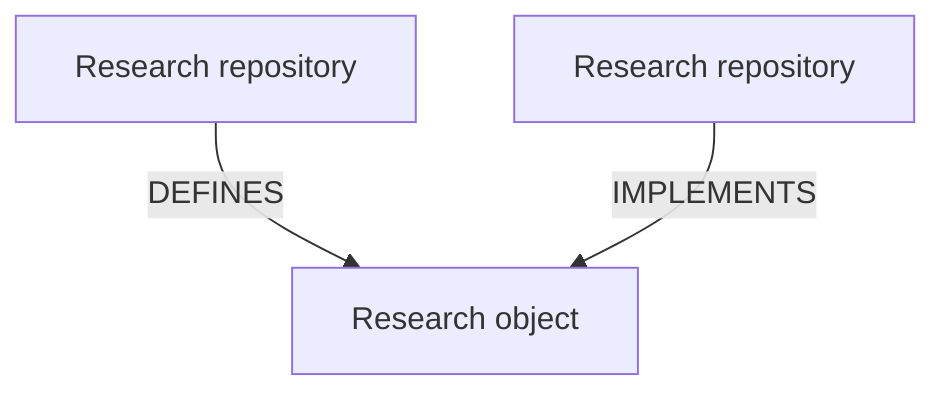

# Reactive Research Specification

> Specification for change-aware, machine-resolvable research graphs.

Reactive Research is a model for organizing research
so that relationships among
claims, definitions, evidence, implementations, experiments,
decisions, and other research objects are
explicit, typed, versioned, and machine-resolvable.

Its central idea is simple:

> When a research object changes,
> the research that depends on it should become visible.

Reactive Research identifies what may need to be
reconsidered, re-executed, re-proved, re-reviewed,
or otherwise revalidated
because an upstream research commitment changed.

## Motivation

Research increasingly spans
repositories, institutions, disciplines, computational artifacts,
formal models, datasets, publications,
laws, policies, evidence, and decisions.

The relationships among these artifacts are often recorded
only in prose, citations, filenames, or researcher memories.

As research programs grow,
relationships become difficult to maintain.
Reactive Research helps makes them manageable.

A research contribution can declare:

- what it defines;
- what it implements, verifies, tests, or instantiates;
- what it depends on;
- what evidence it produces;
- what informs it;
- which versions of upstream objects were used; and
- which graph snapshot supported a particular result.

These declarations form a **typed research graph**.

## Core Model

Reactive Research treats research outputs
as addressable **research objects** connected by typed relations.

Examples of **research objects** include:

- claims;
- definitions;
- theorems;
- propositions;
- laws and regulations;
- legal holdings;
- policies;
- datasets;
- evidence artifacts;
- experiments;
- models;
- formalizations;
- implementations;
- measurements;
- decisions;
- interpretations; and
- published results.

Example:



The research object is visible as a first-class node.
Repository-to-repository dependencies
may be derived from these relationships.

## Reactive Change

Suppose a research object changes.
Reactive Research asks:

- Which objects directly depend on it?
- Which downstream results may be affected?
- What kind of relationship connects them?
- What action does that relationship require?
- Which results have already been validated against the new version?
- Which results still reflect an earlier graph state?

Different relationships create different obligations.

- A changed software dependency may require rebuilding.
- A changed scientific definition may require reanalysis.
- A changed theorem may require reproving dependent results.
- A changed dataset may require rerunning experiments.
- A changed law may require reconsidering legal analyses or decisions based on it.
- A changed evidentiary assumption may require reevaluating a claim.
- An informational relationship may not require any action.

Reactive Research concerns
**typed propagation of research obligations**.

## Initial Relations

The initial model distinguishes:

### DEFINES

The source introduces or owns an addressable research object.

### IMPLEMENTS

An artifact formalizes, verifies, realizes, tests, instantiates, or operationalizes an addressable research object.

### DEPENDS

A result requires another research object or artifact for its validity, execution, or interpretation.

Dependency kinds must remain distinguishable.

Examples include:

- build dependencies;
- semantic dependencies;
- evidentiary dependencies;
- data dependencies; and
- methodological dependencies.

### INFORMS

An intellectual or contextual relationship exists, but no stronger machine-checkable dependency is asserted.

### EVIDENCES

An artifact supplies evidence bearing on a claim, result, interpretation, or decision.

Additional relation types may be introduced only when their semantics and resulting obligations are clear.

## Research Graphs

A Reactive Research graph is:

- typed;
- versioned;
- resolvable;
- provenance-aware;
- capable of representing cross-repository relationships;
- capable of representing cross-organization relationships; and
- designed for federation rather than permanent dependence on one central authority.

The graph may contain cycles where semantics permit.
Acyclicity is a property of particular relation classes,
not a universal assumption about research.

## Graph Snapshots

A graph **snapshot** records a resolved state of
participating research objects and relationships at a particular point.
A snapshot should make it possible to determine:

- which object versions were present;
- where each object was defined;
- which revision supplied it;
- which relationships were resolved;
- which validation rules were applied; and
- which downstream work was considered current against that graph state.

Research results state what they concluded
and the **research graph**
against which those conclusions were established.

## Impact and Revalidation

A change to an upstream object
creates an **impact set**
consisting of downstream objects
connected through relationship types
whose semantics require reconsideration.

Being in an impact set means
that the result's current status relative
to the changed upstream object
has not yet been established.

Reactive Research should distinguish states such as:

```text
current
affected
revalidation-required
revalidated
superseded
unresolved
```

Exact lifecycle vocabulary will be part of the specification.

## Applications

Reactive Research is designed to support
research and reasoning across domains.

### Science

Connect definitions, datasets, experiments,
models, analyses, evidence, and conclusions.

### Law

Connect statutes, regulations, cases, holdings,
interpretations, evidence, legal claims, and downstream analyses.

### Engineering

Connect specifications, requirements, implementations,
tests, evidence, and assurance claims.

### Policy

Connect evidence, assumptions, policy claims, decisions,
implementation mechanisms, and evaluations.

### Formal Research

Connect definitions, propositions, theorems, proofs,
formalizations, executable verifiers, and empirical pilots.

### Decision Systems

Connect claims, evidence, assumptions, rules,
alternatives, analyses, and resulting decisions.

## Relationship to Structural Explainability

Reactive Research originated within the
Structural Explainability research program.

Structural Explainability asks
which distinctions are preserved,
lost, or made visible across structures and transformations.

Reactive Research applies related principles to research itself.

It makes the structure of research dependencies
explicit so that changes and their possible consequences
can be inspected rather than remaining hidden in prose,
repository history, or institutional memory.

Reactive Research is intended to remain independently implementable
and federatable:
organizations can operate their own compatible implementations
and registries while exchanging
resolvable research declarations
across system and organizational boundaries,
without requiring a single central authority.
Its specification should not require
Python, TOML, or any particular repository platform.

## Reference Implementation

The initial implementation is distributed across:

- `reactive-research-spec` - normative concepts and relationships;
- `reactive-research-registry` - resolvable research-object index
  and graph snapshots;
- `reactive-research-tools` - extraction, validation, resolution,
  graph, and impact-analysis tooling.

Existing Structural Explainability infrastructure
may provide compatible implementations
of portions of the model, including repository manifests,
theory references, formal contracts, and accountable surfaces.

## Status

Reactive Research is under active development.
The current implementation is being evaluated against
an existing multi-repository research program.

## License

See [LICENSE](./LICENSE).
